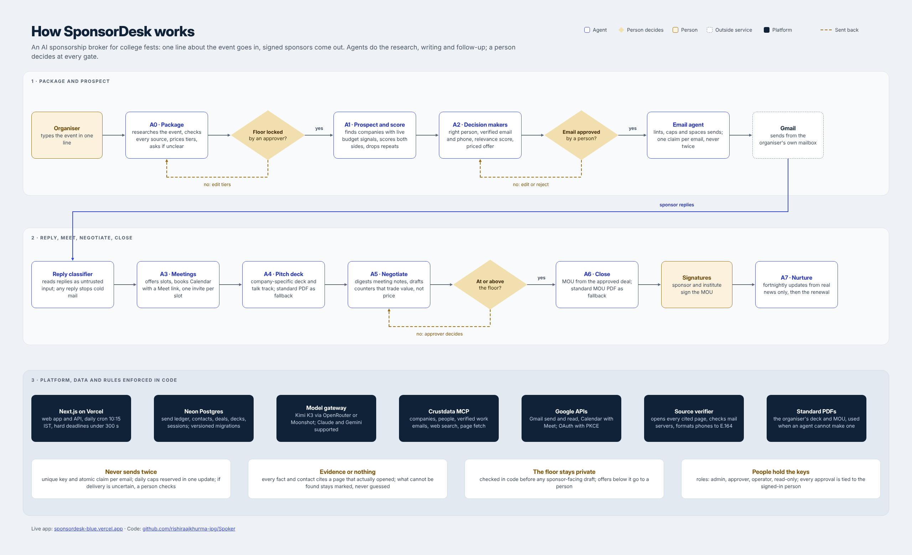

# SponsorDesk

Sponsorship brokerage agents for any event (college fests, conferences, hackathons, meetups, sports and cultural events): find sponsors with live budget signals, write priced offers, follow up without ever double-sending, classify replies, negotiate inside the floor, draft the MOU. Humans only for meetings, negotiation and exceptions. Every decision cites its reasons.

**No AI key needed.** The only paid service is [Crustdata](https://crustdata.com) (`CRUSTDATA_API_KEY`) for company, people and web data. The agents are explicit rules and templates: same input, same output, every score shown factor by factor, and a sponsor email can never instruct the desk.

### What one company costs in Crustdata credits
| Step | Endpoint | Credits |
|---|---|---|
| Discover ~10 companies | `/company/search` | about 6 to 10 |
| Score one company | `/company/enrich` (no `people` group: it is megabytes) | 2 |
| Find decision makers | `/person/search` (12 results) | about 3 |
| Business emails for the top 2 | `/person/enrich` with `contact.business_emails` | 4 |
| Event brief web check | `/web/search/live` | 1 |

Roughly 10 credits per fully researched sponsor. Credits are only charged when a call returns data.

## Try the demo

A clickable demo runs on GitHub Pages with fictional sample data: see the link in this repository's About panel. It runs entirely in your browser (`demo/`), so there is no real login, nothing is sent, and your changes stay in your own browser. The real app needs a server and a database; `Run it on your laptop` below shows how.

## What you see

- **Guided event brief.** Type the event the way you would describe it to a sponsor. A live meter scores the brief and shows what is missing (organiser, dates, footfall, audience, goal, postal address) and why each matters, with one-click examples. Then pick the sponsor categories you want (14, mapped to Crustdata industries) and any brands you already have in mind, or skip and let the desk choose.
- **Companies.** A priority list where every card says who the company is, why it fits your event, both scores, the offer and the decision maker. Open one for the full story, people, next steps and timeline.
- **Agents.** The eight agents as two assembly lines (win the deal, close and keep) with live status, real numbers and where they need you.
- **Ask the desk.** A chat assistant on every screen that explains what is going on, why a company was picked, who to contact, what is waiting for you and how to do anything. It reads the desk's own data and needs no AI key. Optional: a free `GEMINI_API_KEY` from Google AI Studio makes replies more conversational; it only sees the same facts.
- **Sarvam (optional).** With `SARVAM_API_KEY` set: ask the desk by voice or in Hindi and other Indian languages and hear the answer, read sponsor replies written in Indian scripts, and dictate meeting notes in any Indian language. Without the key nothing changes. Assistant facts, sponsor replies and dictated notes are sent to Sarvam to do this.
- Theme: "Marigold" (indigo and festival gold) in light and dark, plus three more presets, built on the shadcn Base UI admin template (Next.js 16, Tailwind 4).

## Run it on your laptop (no database account)

Node 22.5 or newer:

```bash
npm install
SQLITE_PATH=./desk.db APP_PASSWORD=choose-a-password CRUSTDATA_API_KEY=your-key npx next dev
```

Open http://localhost:3000 and sign in with any email and that password (the first sign-in creates the admin).

## How it is built



## Links

| | |
|---|---|
| Live app | https://spoker-agent.vercel.app/ |
| Sample sponsor deck (Cult.fit x Aavhan) | https://sponsordesk-blue.vercel.app/d/5fa28c2a505a45ff8957 |
| Demo walkthrough (Loom) | https://www.loom.com/share/4ec4186105f14dc88216a162973b5b2a |
| Sample MOU drafted by A6 (Zepto x E-Summit 2027, unsigned draft) | [docs/sample-mou-zepto-esummit-draft.pdf](docs/sample-mou-zepto-esummit-draft.pdf) |
| Architecture diagram (image) | [docs/sponsordesk-architecture.png](docs/sponsordesk-architecture.png) |
| Second walkthrough (Loom) | https://www.loom.com/share/22be30b955e94dc7b3f8815d8f7cefee |
| Standard deck and MOU used when the agent cannot produce one | [public/fallback](public/fallback) |

## What it does

| Stage | Agent | In this app |
|---|---|---|
| Package | A0 | One line in (name, organiser, dates, city, footfall, goal). One Crustdata web search for published numbers and past sponsors. Tiers priced by a stated rule (about INR 40 per attendee for title, scaled by event type), floor at 80% of the smallest tier, all editable |
| Prospect | A1 | Crustdata company search: companies in your country with a funding round in the last 12 months or 8%+ headcount growth, in industries that fit your event type; brand-unsafe categories skipped |
| Score | A1 | Dual point of view: our view x the company marketing team's view; priority = the lower of the two; every score shows its signals |
| Decision makers | A2 | Crustdata people search for brand, partnership, campus or CSR owners at that company (not the CEO at 200+ people); alumni of the organiser flagged as warm paths; business email only if it belongs to THIS company (Crustdata often returns an address from a previous employer, which is rejected); checked (syntax, domain, MX) and scored out of 100 with the breakdown |
| Pitch | A2 | First email is a priced offer (activation, price range, metric, reply "send"), never a meeting request |
| Follow up | A2 | Max 3 emails, one thread per company, auto follow-ups only while nobody replied |
| Replies | A2 | Gmail sweep, rule-based classifier (interested, meeting, questions, referral, not now, declined, opt-out, out of office with return date, bounce), amounts in lakh or INR, prompt-injection attempts flagged; cold mail stops for the whole company |
| Meet and negotiate | A3 to A5 | Scheduling emails, a 10-slide company deck with talk track, meeting notes turned into goals, next steps and a recap; below-floor offers become exceptions with a three-option trade counter (never a discount) for a human to approve |
| Close and nurture | A6, A7 | 11-section MOU draft from the deal sheet; fortnightly sponsor updates from the team's own news |

## Safety rules enforced in code (`lib/ledger.ts`)

- Every email passes the linter (no em/en dashes, no placeholders, signature, postal address, opt-out on cold mail) before it can be queued.
- Only a signed-in user with the approver or admin role can approve; the approver is taken from the session, never from the request. The agent can only auto-approve follow-ups to companies that never replied.
- A unique key per email plus an atomic claim. If Gmail may have sent a message but we could not confirm it (timeout, 5xx, database error after sending), it becomes `send_unknown`, is checked against Gmail Sent, and goes to a person after 6 hours. It is never resent automatically. Exactly-once delivery through an external mail provider cannot be guaranteed; this design prefers a possibly-missed email that a human resolves over a duplicate.
- Daily caps and spacing are reserved with one conditional UPDATE, so concurrent workers cannot exceed them; suppression list for opt-outs and bounces; erasure redacts the person from contacts, emails, replies, meeting notes, decks, logs, exceptions and MOUs (DPDP).
- Out-of-office pauses a sequence instead of killing it; a reply on a live deal never resets its stage.
- Cold emails are held until the organisers' written permission is recorded in Settings.

## Accounts and security

Sign in with email and password. On a new desk the first sign-in with `APP_PASSWORD` creates the admin; the admin adds people in Settings with a role: admin, approver, operator or read-only. Sessions are random tokens stored hashed, expire after 7 days, and can be revoked. Logins are rate limited. Every write must come from the app's own origin. Google OAuth uses a one-time state bound to the session plus PKCE; the refresh token is stored encrypted (`TOKEN_KEY`, else `APP_PASSWORD`). `GET /api/cycle` only runs for Vercel Cron with `CRON_SECRET`.

## Tests

Node 22.5 or newer (`.nvmrc`). `npm run test:all` runs the ledger, email-engine failure, security and decision-maker, and end-to-end agent tests (A0 to A7 plus the reply classifier), with Crustdata, Gmail and DNS mocked from the live API's response shapes (the test fails if any AI provider is called) and `node:sqlite` standing in for Postgres. These prove the logic; row locking itself is Postgres behaviour and is not exercised by SQLite. CI runs typecheck, tests and build on every push and pull request.

## Deploy on Vercel

1. Import this repo in Vercel.
2. Storage > Create Database > Neon (free). This adds `DATABASE_URL`.
3. Environment variables: `APP_PASSWORD`, `CRUSTDATA_API_KEY`, `CRON_SECRET`, optional `TOKEN_KEY` and `SD_COUNTRY` (default `IND`), and for Gmail `GOOGLE_CLIENT_ID`, `GOOGLE_CLIENT_SECRET`. No AI key.
4. Redeploy. Sign in with your email and `APP_PASSWORD` (this creates the admin), add your team in Settings, then type the event in one line.

### Gmail (optional, otherwise draft mode)
Google Cloud Console > APIs & Services: enable the Gmail API, OAuth consent screen (External, Testing, add your Gmail as a test user), Credentials > OAuth client ID > Web application, authorised redirect URI `https://<your-app>.vercel.app/api/google/callback`. Put the client id and secret in Vercel, redeploy, then Settings > Connect Google (admin).

The daily cycle runs on weekdays at 10:15 IST (Vercel cron) and from the "Run daily cycle" button.

## Skill pack

`skills/` holds the full SponsorDesk skill pack (orchestrator, email agent, A0 to A7, council reviewer, demo mode) for use directly in Claude, plus vendored MIT skills from samber/dev-event-organizer-skills and coreyhaines31/marketingskills.

## Honest limits

- Contacts and signals are only as good as Crustdata's coverage; the app never invents an email, and unverified emails raise an exception for a person to check.
- Templates are plain and consistent rather than creative. Every draft waits for a human, so edit freely before approving.
- Prices are a rule of thumb. Check them against what peer events charge before you lock the floor.
- Meeting digests use keyword extraction: paste clean notes (Google Meet's notes work well) and read the recap before approving it.
- The MOU is a draft for the institute's office, not legal advice. GST and TDS treatment must be confirmed by the accounts office.
